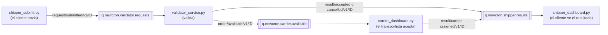
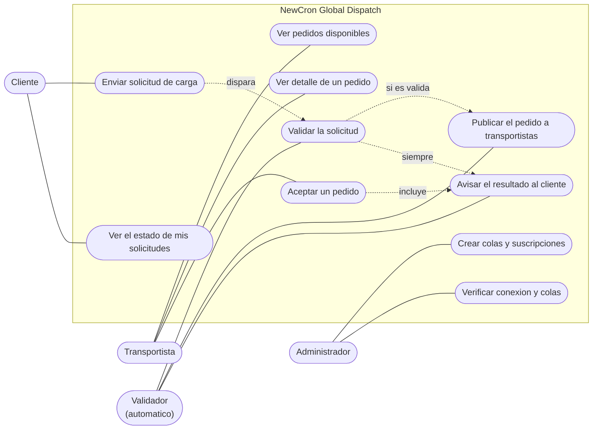
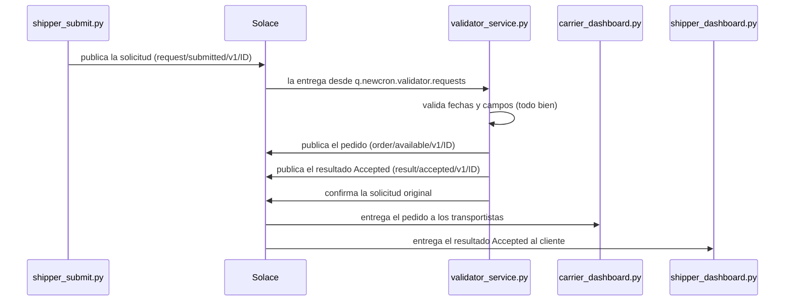
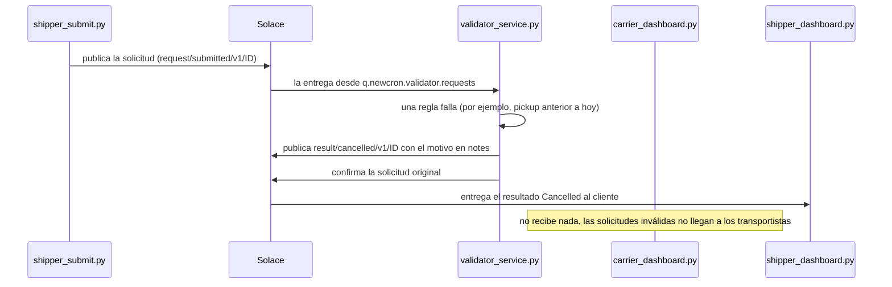
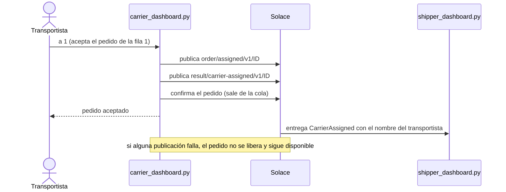

# NewCron - Global Dispatch

NewCron conecta a dueños de predios de autos que compraron vehículos en una subasta con conductores de car haulers que los transportan. Este proyecto es la parte que recibe las solicitudes de carga, las valida y las reparte usando Solace como broker de mensajes.

La idea es simple: el cliente manda una solicitud y un validador revisa las fechas. Si está bien, la solicitud pasa a los transportistas. Si no, se cancela y se le explica el motivo al cliente. En los dos casos el cliente ve el resultado en su propio dashboard.

Está hecho en Python 3.9 o superior con la librería oficial de Solace (`solace-pubsubplus`). Todo corre por consola y lo probé con un servicio de Solace Cloud.

## Cómo funciona



Son cuatro programas y tres colas:

- `shipper_submit.py` hace de cliente y manda solicitudes.
- `validator_service.py` lee las solicitudes, las valida y publica el resultado.
- `carrier_dashboard.py` muestra los pedidos disponibles y deja que un transportista acepte uno.
- `shipper_dashboard.py` muestra al cliente, en vivo, qué pasó con cada solicitud.

Los tópicos cuelgan de `newcron/dispatch/` y siguen el orden que recomienda Solace (`objeto/verbo/versión/id`). El `ID` del final es el `shipperOrderId`:

```
request/submitted/v1/ID         solicitud del cliente, todavía sin validar
order/available/v1/ID           pedido válido, disponible para transportistas
order/assigned/v1/ID            un transportista tomó el pedido
result/accepted/v1/ID           resultado: solicitud aceptada
result/cancelled/v1/ID          resultado: solicitud cancelada (con el motivo)
result/carrier-assigned/v1/ID   resultado: un transportista tomó la carga
```

Cada cola se suscribe a un grupo de esos tópicos:

| Cola                           | Se suscribe a                             | Access Type   |
| ------------------------------ | ----------------------------------------- | ------------- |
| `q.newcron.validator.requests` | `newcron/dispatch/request/submitted/v1/>` | Non-Exclusive |
| `q.newcron.carrier.available`  | `newcron/dispatch/order/available/v1/>`   | Non-Exclusive |
| `q.newcron.shipper.results`    | `newcron/dispatch/result/>`               | Exclusive     |

Las colas se crean a mano en el broker antes de correr

## Reglas de validación

El validador (`newcron/validator.py`) revisa esto:

1. `pickupDate` no puede ser anterior a hoy.
2. Si `pickupDate` es hoy, la solicitud no puede llegar después de las 3:00 p.m. (a las 15:00:00 en punto todavía se acepta).
3. `deliveryDate` tiene que ser al menos un día después de `pickupDate`.
4. El payload debe ser un JSON válido con lo mínimo: `shipperOrderId`, `price` mayor a 0, al menos dos `stops` (con `city`, `state` y `postalCode`) y al menos un `vehicle` (con `year`, `make` y `model`).

Si hay varios errores, todos van juntos en `notes`. Las respuestas tienen el formato del enunciado:

```json
{ "shipperOrderId": "6600111", "status": "Accepted", "notes": "You will receive an email when a carrier accepts this dispatch request" }
{ "shipperOrderId": "7743789", "status": "Cancelled", "notes": "Pickup date cannot be earlier than the current date." }
```

"Hoy" y las 3:00 p.m. se calculan con la hora de la máquina donde corre el validador. Si se quiere usar hora de Estados Unidos, se define `BUSINESS_TIMEZONE=America/New_York` en el `.env`.

Un detalle del enunciado: el JSON de ejemplo está mal formado, le falta una coma entre `"vehicles": [...]` y `"transportationReleaseNotes"`. El sistema lo trata como cualquier otra solicitud inválida (queda `Cancelled` con el motivo `Payload is not valid JSON`) y rescata el `shipperOrderId` para que el cliente sepa cuál pedido falló. Hay un ejemplo en `samples/order_malformed.json`.

## Casos de uso



- **Cliente:** envía solicitudes con `shipper_submit.py` y ve el estado de cada una en `shipper_dashboard.py` (`Accepted`, `Cancelled` con su motivo, o `CarrierAssigned` con el nombre del transportista).
- **Transportista:** en `carrier_dashboard.py` ve la lista de pedidos, puede abrir el detalle de uno y aceptarlo. Al aceptar, el pedido sale de la cola y el cliente recibe el aviso.
- **Validador:** es automático. Revisa cada solicitud y publica el pedido, el resultado, o solo el resultado si la solicitud no pasó.
- **Administrador:** crea las colas en Solace y usa `check_setup.py` para comprobar que todo está conectado.

## Diagramas de secuencia

`ID` es el `shipperOrderId`.

**Solicitud válida**



**Solicitud cancelada**



**Un transportista acepta un pedido**



## Cómo levantarlo

Se necesita Python 3.9 o superior, Git y una cuenta de Solace Cloud con un servicio creado.

**1. Instalar**

```bash
python -m venv .venv
.venv\Scripts\activate            # en Linux/Mac: source .venv/bin/activate
pip install -r requirements.txt
copy .env.example .env            # en Linux/Mac: cp .env.example .env
```

**2. Llenar el `.env`**

Los datos de conexión están en Solace Cloud, en la pestaña _Connect_ de tu servicio, sección _Solace Messaging_ (protocolo Secured SMF): `SOLACE_HOST` (empieza con `tcps://` y termina en `:55443`), `SOLACE_VPN`, `SOLACE_USERNAME` y `SOLACE_PASSWORD`. El `.env` no se sube al repositorio.

**3. Windows: certificados**

En Windows la conexión puede fallar con `Failed to load trust store`, porque la librería de Solace no encuentra una carpeta de certificados raíz para validar el broker. Se arregla con:

```bash
python make_trust_store.py
```

El script copia a `trusted-store/` los certificados raíz que Windows ya trae instalados (la carpeta no se sube al repo) e imprime una línea `SOLACE_TRUST_STORE=...` que hay que pegar en el `.env`. Como último recurso, solo para pruebas, se puede poner `SOLACE_VALIDATE_CERT=false`, aunque así no se verifica la identidad del broker.

**4. Crear las colas**

En el Broker Manager de Solace (_Queues → + Queue_) se crean las tres colas de la tabla de arriba. En cada una hay que poner _Non-Owner Permission_ en `Consume` y, en su pestaña _Subscriptions_, agregar el tópico que le toca. `python check_setup.py --show-setup` imprime esa lista para copiarla.

Después se comprueba que todo responde:

```bash
python check_setup.py
```

Esto confirma la conexión y que las colas existen, pero no revisa las suscripciones. Esas hay que mirarlas a ojo en el Broker Manager.

**5. Correr**

Cuatro terminales, cada una con el entorno virtual activado:

```bash
python validator_service.py        # 1. el validador
python carrier_dashboard.py        # 2. transportistas (pide un nombre al iniciar)
python shipper_dashboard.py        # 3. clientes (se actualiza solo)
python shipper_submit.py --demo    # 4. manda cinco solicitudes de prueba
```

`--demo` calcula las fechas a partir de hoy, así que siempre sirve. Esto es lo que debería pasar:

| Solicitud                         | Resultado                                                            |
| --------------------------------- | -------------------------------------------------------------------- |
| Pickup mañana, delivery en 2 días | `Accepted`, aparece en el dashboard de transportistas                |
| Pickup en el pasado               | `Cancelled`                                                          |
| Delivery el mismo día del pickup  | `Cancelled`                                                          |
| Pickup hoy                        | `Accepted` si son las 3:00 p.m. o antes, `Cancelled` si es más tarde |
| JSON mal formado                  | `Cancelled`                                                          |

También se pueden mandar archivos propios: `python shipper_submit.py samples/order_future.json` (o `samples/` para mandar todos).

En el dashboard de transportistas, `Enter` refresca la lista, `a <número o id>` acepta un pedido, `v <número o id>` muestra el detalle y `q` sale. Cuando se acepta uno, el dashboard de clientes cambia ese pedido a `CarrierAssigned`.

## Pruebas

```bash
python -m unittest discover -s tests -v
```

Son 45 pruebas y no necesitan Solace: cubren las reglas de fechas (incluido el límite de las 3:00 p.m.), la validación de campos, que cada tópico caiga en la cola correcta y el comportamiento de los programas con un broker simulado.

## Cosas a tener en cuenta

- Los pedidos que llegan al dashboard de transportistas quedan sin confirmar en Solace hasta que alguien los acepta. Si el transportista cierra el programa, el pedido vuelve a la cola y no se pierde.
- El validador confirma una solicitud solo después de haber publicado todo lo que tenía que publicar. Si algo falla, Solace la entrega otra vez. En el peor caso, un pedido puede duplicarse.
- La cola de resultados es exclusiva, así que solo funciona con un dashboard de cliente a la vez. Para varios clientes habría que usar una cola por cliente.
- Los resultados se van borrando de la cola al leerlos, por eso el dashboard de clientes guarda el historial en `data/shipper_history.jsonl`.
- El estado `CarrierAssigned` no venía en el enunciado. Lo agregué para que el cliente sepa cuándo un transportista tomó su carga.

## Estructura

```
validator_service.py     validador
carrier_dashboard.py     dashboard de transportistas
shipper_dashboard.py     dashboard de clientes
shipper_submit.py        simulador de clientes
check_setup.py           diagnóstico de conexión y colas
make_trust_store.py      certificados para Windows
newcron/                 validator.py (reglas), topics.py, broker.py, settings.py, console.py
samples/                 payloads de ejemplo
tests/                   pruebas unitarias
.env.example             plantilla de configuración
requirements.txt
```
